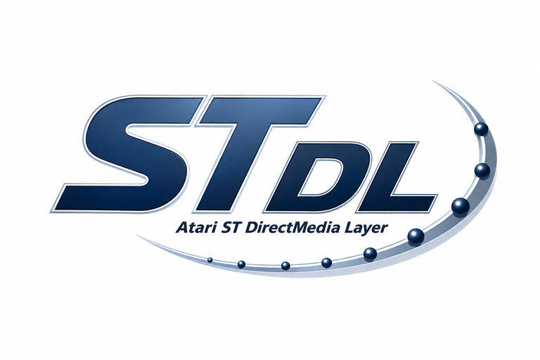

<p align="center">
  
</p>

# STDL - Atari ST DirectMedia Layer

An easier way to create games for the Atari ST, TT & Falcon,
by [Neil Rackett](https://neilrackett.com/atarist).

## Introduction

STDL is a planar-native library for creating high performance games and
porting SDL 1.2 content to the Atari ST, TT & Falcon.

It enables you to create a single binary that works on any computer in the
Atari ST family, with optional progressive enhancement baked into its core:

- Create games that run in ST low res on any ST-compatible computer
- Add 256 colour graphics for enhanced experiences on TT and Falcon
- Expand to 240 rows on TT and Falcon, or on every machine using ST overscan

### Why not just use SDL?

If you only want to target TT and/or Falcon, SDL 1.2 is a good option,
but on a stock ST it's just not viable: c2p and the framework overhead mean
it's slow and uses around half the RAM on a 512KB ST, and it only works in
greyscale.

Porting an SDL2 program to a stock TT or Falcon? STDL's optional SDL2 add-on
(`addons/sdl2/`, [docs/sdl2.md](docs/sdl2.md)) draws 256-colour textures on
STDL's responsive screen and converts only what changed each frame. It is the
one place STDL is chunky, it is never part of the core library, and a program
gets it only by asking for it.

With STDL, it's in full colour and 50-60fps on a 520 ST is truly achievable.

### What STDL does differently

There is no chunky backbuffer and no c2p anywhere in the core library's
pipeline: interleaved planar is the native format, assets are converted
offline, and spans, rects and blits are the primary verbs. The SDL2 add-on,
for SDL2 programs on a TT or a Falcon, is the one exception, and it lives
apart (`addons/sdl2/`).

For engines that decode byte-per-pixel sprite frames at runtime,
`STDL_BlitIndexed8` draws chunky frames straight into the planes through a
colour map, (one pass, no backbuffer) `STDL_CreateSurfaceFrom` wraps
engine-owned framebuffers as surfaces, `STDL_BlitSurfaceEx` composes planar
frames against a foreground/priority plane, and `STDL_Voice` hardware-mixes
four sample voices from the VBL for module-style music.
See `examples/chunky.c`.

Modern controllers work through the ordinary SDL joystick API: when an
[Xpad](https://github.com/neilrackett/atarist-xpad) provider is present
(a SidecarTridge running MD/Sidepad, for example), joystick 0 grows to
six axes, thirteen buttons and a hat with real analogue values, and the
joystick key emulation picks the pad up too. Ports need no changes:
button 0 stays fire, axes 0 and 1 stay the left stick, and with no
provider everything reads exactly as a plain ST joystick.
`STDL_PadRumble(low, high, ms)` pulses the pad's motors when its
provider offers them, and returns -1 without doing anything otherwise.

On an STE, `STDL_SetScrollOrigin` shows a 320x200 window of a larger
planar surface positioned to the pixel - the video base, LINEWIDTH
and HSCROLL registers programmed from the VBL in the order the
Shifter latches them, so the picture never jumps a group when the fine
scroll crosses zero - and the smooth-scrolling tile engine model
(a play field one tile larger than the screen, only the incoming strip
redrawn) costs no CPU at all. See `examples/hwscroll.c`.

`STDL_OpenTopBorder` trades the top border for 28 extra lines - 228
visible instead of 200 on any ST, one timer interrupt per frame and
no cycle counting - so a game whose world is taller than 200 lines shows
it whole instead of cropping or squashing. `STDL_OpenBottomBorder` opens
the other end (245 lines, seamless: the flick that fools the GLUE is
placed from the Shifter's video counter with loops calibrated against
real scanlines and the machine's own timing when the border opens,
and the GLUE's test position is found by trying rather than assumed,
so it lands on any CPU speed and any boot - verified on a real 16MHz
Mega STE),
and opening both combines them automatically into a 273-row screen
filling the display edge to edge. While any border is open, each
BLiTTER operation is placed from the beam's position so it ends before
the border's timing window, or is split around it, so a blit never
holds the CPU off the border and throughput stays within 14-28% of
the no-border figure; palette writes are staged to the vertical
blanking so they can never flash mid-frame. See `examples/overscan.c`.

`STDL_OpenRasters` changes one or two colour registers every few lines
down the picture from tables filled a frame ahead - copper bars, skies, a
gradient behind text - with the Timer C prefix that keeps them steady,
Timer B shared safely with the borders (each refuses while the other
holds it), and the vectors put back however the program exits.

`STDL_FillPolygon` fills convex polygons straight from their edges -
set, or XORed, ORed or cleared into a colour's planes, with shared
edges tiling exactly - for flat-shaded 3D and glenz, with a faster way
for triangles. `STDL_FillPolygonPattern`
fills them with a two-colour 4x4 pattern (PICO-8's `fillp`: dither
shading, fog, screen-door transparency) from 12.4 sub-pixel vertices,
under the same exact edge rule. `STDL_StagePalette(1)`
holds palette changes for the vertical blank, so a fade or a cycle never
splits a frame. Music can be played from memory, sought, and read back
for meters (`STDL_MusicFromMemory`, `STDL_SeekMusic`,
`STDL_GetMusicRegisters`).

`STDL_EnableMouse(0)` stops the IKBD reporting a mouse the game never
reads - three ACIA interrupts per movement that, with a border open,
are enough to delay the timers a flick depends on and flicker the
screen.

`STDL_OpenInput()` takes the keyboard, mouse, joystick and pad without
setting a video mode, for a program that keeps the screen it started
on - a tool that prints, in medium resolution or on a mono monitor -
or drives its own. A TT's or a Falcon's 256 colours come with
`stdl_responsive.h`.

`STDL_PauseVoices()` and `STDL_ResumeVoices()` stop and restart the
sample mixer's DMA without giving up the volume table its open call
spends a frame building - for ports whose device is idle through
menus and cutscenes, where an open sound DMA on a real STE clicks
about once every thirty seconds whatever is in the ring. The stop is
deferred until the ring has drained to silence, so it never lands
mid-waveform.

`STDL_SetRefresh(50 | 60)` switches the display's sync rate and returns
the rate that actually took effect - ten more frames a second on a game
already inside its frame budget, on a machine and monitor that will take
it. The VBL rate moves with it, so `STDL_Music` and the voice
sequencer tick are rate-aware and anything counting frames should time
from `STDL_GetTicks` instead; a
border forces 50Hz for as long as it is open, the overscan tricks being
PAL-timed.

`<stdl/stdl_math.h>` is the 68000's own 16-bit multiply and divide
(`STDL_MulS16`, `STDL_DivS16`, `STDL_FixDiv` for 16.16 slopes,
`STDL_FixMul` for a 16.16 product bit-exact with the 64-bit one), because
gcc 4.6 silently turns any product it cannot prove 16-bit into a
`__mulsi3` call eight times the price - a loop counter, two bytes, an
`int`. `tools/libcalls.sh` lists every such call an object makes, per
function, and fails a build on any its allowlist does not name; the
library's own build runs it.

Anything that cannot be done cheaply in planar has been removed rather than
emulated; see [docs/limits.md](docs/limits.md).

## Layout

| Path              | Contents                                                                            |
| ----------------- | ----------------------------------------------------------------------------------- |
| `include/stdl/`   | public headers, one per module                                                      |
| `include/compat/` | SDL.h and SDL_mixer.h - the SDL 1.2 compatibility shims                             |
| `addons/sdl2/`    | the optional SDL2 add-on for a TT or a Falcon (docs/sdl2.md), built by `make sdl2`   |
| `src/`            | video, surface, surfacefrom, draw, shapes, blit, blit8, blitter, planes, palette,   |
|                   | event, cursor, time, dirty, vbl, sprite, tileset, text, drawchar, indexed, asset,   |
|                   | bmp, degas, audio, voice, music, sfx, tone, opl, ym, compat, mixer, palstage,       |
|                   | polygon, polypat, raster, spritebatch                                               |
| `tools/stdlconv/` | asset converter: image quantise + planar, sprite/tile/font banks, Degas PI1,        |
|                   | WAV (incl. MS ADPCM) to STE DMA rates, MIDI and YM2151 (VGM) to YM music, C-arrays  |
| `tools/libcalls.sh` | per-function libgcc arithmetic calls (multiply, divide, 64-bit, float) in object files, with an allowlist gate |
| `examples/`       | ported SDL 1.2 test programs + original STDL demos and their assets (public domain) |
| `docs/`           | format.md (the contract), porting.md, limits.md, design-overview.md, sdl2.md        |
| `.claude/skills/` | the `stdl` porting skill (auto-discovered by Claude Code in this repo)              |
| `dist/`           | build output: .TOS binaries + copied assets (untracked; doubles as a GEMDOS drive)  |

## Building

The easiest way is to cross-compile with `m68k-atari-mint-gcc` using
[atarist-toolkit-docker](https://github.com/sidecartridge/atarist-toolkit-docker):

```
stcmd make
```

This produces `libstdl.a` in the project root and all of the example programs
in `dist/`, which doubles as a Hatari GEMDOS drive for testing:

```
hatari --machine ste dist/TSPRITE.TOS
```

Clone with `--recursive`, or run `git submodule update --init`: Xpad is
a submodule at `lib/xpad`, and the library does not build without it.

The SDL2 add-on builds apart, and only when asked: `stcmd make sdl2` makes
`libstdl-sdl2.a` (and `-cmini.a`) and `dist/SDL2DEMO.TOS`.
[docs/sdl2.md](docs/sdl2.md) says how a program links it.

**Link your game against libcmini, not mintlib, unless it needs
mintlib.** The examples link mintlib, the toolchain's default, but a
game that uses stdio, stdlib, string and the GEMDOS/XBIOS bindings and
nothing of MiNT's own (processes, signals, sockets) is about 100K
smaller on libcmini - one port went from 242,624 bytes to 141,551, and
on a 512K ST from 23K free after loading to 107K. Build STDL against
libcmini's headers as well, since `libstdl.a` will not mix with it:

```
stcmd make libstdl-cmini.a
m68k-atari-mint-gcc -nostdlib -L$CMINI/lib -Wl,--traditional-format \
    -o GAME.TOS $CMINI/lib/crt0.o objs... libstdl-cmini.a -lcmini -lgcc
```

with the game's own sources compiled with `-I$CMINI/include`
(`/freemint/libcmini` in the toolchain container), and its stack set
in the program (`long _stksize = 32768;`), which libcmini's start-up
reads in place of the link's `--stack`. `docs/porting.md` has the
checks to make when switching.

**If your game's Makefile decides when to rebuild `libstdl.a` by
globbing STDL's sources, glob both directories.** Not every source is
under `src/` any more:

```make
STDL_SRCS = $(wildcard $(STDL)/src/*.c) $(wildcard $(STDL)/lib/xpad/src/*.c)
```

A glob that only sees `src/` will not notice an Xpad submodule bump, so
it will happily link an archive built against the previous ABI. Objects
also build into `$(STDL)/obj/` now rather than beside the sources, so
anything looking for `$(STDL)/src/*.o` wants `$(STDL)/obj/src/*.o`.
An earlier build may have left orphaned `.o` files next to the sources;
`make clean` no longer removes those, so delete them once by hand.

## Status

320x200, 4 planes, 16 colours on every machine; with `stdl_responsive.h`,
256 colours and 320x240 on a TT or a Falcon, and 320x240 on an ST with its
bottom border open. The library and the SDL 1.2 test-suite ports below all
run under EmuTOS/TOS on Hatari:

| Example      | Exercises                                                                        |
| ------------ | -------------------------------------------------------------------------------- |
| TBITMAP.TOS  | 1bpp expansion, band fills, mouse events                                         |
| GRAYWIN.TOS  | fills, clipping, palette                                                         |
| TESTWIN.TOS  | BMP loading, surface blits, palette fades                                        |
| TSPRITE.TOS  | colour-keyed sprite blits, dirty rects, FPS                                      |
| TPALETTE.TOS | palette animation on a 16-entry budget; `-stage` lands each change in the blank  |
| CHECKKEY.TOS | raw IKBD keyboard, no video mode: key-ups, modifiers, unicode                    |
| TTIMER.TOS   | 200Hz timing, cooperative timers                                                 |
| TBLITSPD.TOS | blit throughput baseline                                                         |
| TVIDINFO.TOS | capability report + fill/blit/flip benchmarks                                    |
| TKEYS.TOS    | keysym name table dump                                                           |
| TJOY.TOS     | joystick port 1 as SDL joystick 0; 6 axes/13 buttons when an Xpad pad is present, shoulders rumble |
| LOOPWAVE.TOS | STE/Mega STE DMA sample playback (STDL_Audio)                                    |
| TCURSOR.TOS  | software mouse cursor with save-under                                            |
| PLAYMUS.TOS  | YM music (stdlconv midi -> STDL_Music) + sample chunks via the SDL_mixer shim    |
| MUSICVU.TOS  | YM music from memory: VU meter from the stream's registers, position, seeking    |
| POLYDEMO.TOS | convex polygons XORed into single planes, a glenz look; T: triple buffering      |
| PATDEMO.TOS  | pattern-filled polygons: Bayer dither shading, a screen door, sub-pixel motion   |
| RASTERS.TOS  | Timer B rasters: copper bars in colour 0 edge to edge, a gradient in colour 15   |
| SFXDEMO.TOS  | Degas splash, YM effects stealing/restoring music voices, joystick key emulation |
| TONEDEMO.TOS | live notes on the three YM voices: a fourth note displacing and returning        |
| OPLDEMO.TOS  | an OPL2 register stream (the IMF games' music format) replayed as YM notes       |
| BLITCHK.TOS  | BLiTTER vs CPU byte-identical verification at three plane budgets + timing       |
| VBLCHK.TOS   | 50Hz VBL callbacks, then an abnormal exit - the desktop coming back is the pass  |
| OVERSCAN.TOS | border overscan: T top (228), B bottom (245), both combine (273), SPACE closes   |
| RESPDEMO.TOS | one binary, each machine's best screen: 256 colours and 240 rows on a TT or Falcon |
| SDL2DEMO.TOS | the SDL2 add-on on a TT or a Falcon: INDEX8 textures, palette cycling, copying what changed |

Large fills and blits are BLiTTER-accelerated where the hardware has
one, unaligned blits included - the BLiTTER shifts them itself (a
64x32 unaligned blit 7.4ms -> 1.4ms on an emulated STE); the CPU
paths remain the correctness reference, verified byte-identical on
target by BLITCHK.TOS.

Games that do not need 16 colours can say so:
`STDL_SetPlaneBudget(2)` promises no colour index above 3 and every
primitive - fills, spans, blits, sprites, tiles, text, the XOR ops
and the BLiTTER passes - stops maintaining the top two bitplanes.
Measured with BLITCHK.TOS: 1.4x on a stock ST, 1.9x with a
BLiTTER. The default is 4 planes and is bit-for-bit unchanged.

## Ports

The API has been proven and optimised against three formerly SDL-based
games, each in its own repository:

| Game                                                             | What it proved                                                                   |
| ---------------------------------------------------------------- | -------------------------------------------------------------------------------- |
| [FreeNukum](https://downloads.neilrackett.com/atarist-freenukum) | Replaced a bespoke planar shim; renders pixel-identically                        |
| [Sopwith](https://downloads.neilrackett.com/atarist-sopwith)     | STDL backend built beside its hand-written native ST one, to compare performance |
| [Koules](https://downloads.neilrackett.com/atarist-koules)       | 256-colour SVGALIB game, ported to 16 colours and fixed-point physics            |

Sopwith was used as a benchmark, being the only one with a
hand-optimised native ST backend to measure against. The STDL backend
began roughly 1.6x slower than native code on a stock 8MHz ST and is
now around 1.3x.

That is the useful part: the XOR primitives, the batched span and
point primitives, the plane budget and `STDL_PlaySample` all exist
because a real game needed them and profiling said so. Koules also
gave `STDL_Dirty` its first real workout, which was the point of
choosing it.

The gaps the three ports worked around became the rest of the API:
`STDL_SurfaceFromIndexed8` (all three hand-rolled a chunky-to-planar
decoder), `STDL_RemapSurface` (Sopwith recolours every symbol per
faction), `STDL_DrawChar` (Sopwith builds a one-character string 350
times a frame) and `STDL_AddVBL` (Sopwith pokes the TOS VBL queue at
$456 directly, because STDL claimed a slot for its own sound tick
and never offered one). The last of those also fixed a crash: a
program that dies without running `atexit` - a failed `assert`, an
`abort`, a bus error - used to leave a VBL queue entry pointing into
memory GEMDOS had already handed to somebody else, which turned an
out-of-memory into a machine panic one frame later. STDL now cleans
up from the GEMDOS terminate vector, whichever way the program goes.

Because the linker's granularity on m68k-atari-mint is the object
file, each of those lives in its own translation unit and costs
nothing to a program that does not call it: adding all four, and
moving `STDL_SurfaceFrom1bpp` in beside them, made every one of the
three games _smaller_.

Two findings worth repeating for anyone porting: gcc 4.6 turns
`y * stride` into a `__mulsi3` call costing ~270 cycles, which is
more than the pixel work in a short span; and a mixing loop's step
`while (acc >= n) { acc -= n; p += size; }` compiles to one on every
sample - the ring audio device spent 37% of an 8MHz STE on silence
that way until v1.13.0. The `SDL_mixer` shim's chunks now play on the
voice mixer: 5% of an 8MHz STE for one at 6258Hz and 20% for four,
where they used to take all of it by the third.

## Porting with an LLM

The repo ships a porting guide written for AI agents
([.claude/skills/stdl/SKILL.md](.claude/skills/stdl/SKILL.md)): the surface
format contract, API costs, SDL-to-STDL rewrite patterns, stdlconv usage and
the Hatari test loop. It is plain markdown, so it works with any agent:

- **Claude Code** discovers it automatically in this repo (`/stdl`); when
  porting a game in its own repository, symlink it in or install user-wide:

  ```
  mkdir -p path/to/game/.claude/skills
  ln -s /path/to/atarist-stdl/.claude/skills/stdl path/to/game/.claude/skills/stdl
  ```

- **Other agents** (Codex, Cursor, Gemini CLI, ...): reference the file from
  the game repo's AGENTS.md or rules, or paste it into context.

## Licence

Library, headers, converter and build files are licensed under the
[GNU Lesser General Public License version 2.1 (LGPL-2.1)](https://www.gnu.org/licenses/old-licenses/lgpl-2.1.en.html);
see [LICENSE](LICENSE).

Examples, both ports from SDL 1.2 and original STDL demos, are dedicated to the
public domain under
[Creative Commons Zero 1.0 Deed (CC0-1.0)](https://creativecommons.org/publicdomain/zero/1.0/deed.en),
so they can be used as starting points without licence concerns; see
[examples/LICENSE](examples/LICENSE).
